  

  
  
  
  
  

# 🎬 Awesome UI Animation &amp; Motion Design Libraries 🚀✨

> A comprehensive, SEO-optimized curated directory of the best **UI animation libraries**, **motion design frameworks**, **declarative physics engines**, **interactive state machines**, and **vector graphics runtimes** for web, React, Vue, Svelte, iOS, Android, and cross-platform front-end applications.

Whether you are crafting high-performance 60/120 FPS spring transitions, physics-based gesture interactions, responsive page transitions, scroll choreography, or vector animations with Lottie and Rive, this ecosystem index covers top commercial SaaS design tools and cutting-edge open-source repositories.

---

## 📑 Table of Contents
- [📊 Sector Overview &amp; Market Dynamics](#-sector-overview--market-dynamics)
- [🏢 SaaS &amp; Commercial Hosted Platforms](#-saas--commercial-hosted-platforms)
- [💻 Open-Source GitHub Projects](#-open-source-github-projects)
- [📈 Star History](#-star-history)
- [🤝 How to Contribute](#-how-to-contribute)
- [💖 Support](#-support)
- [📄 Disclaimer &amp; License](#-disclaimer--license)

---

## 📊 Sector Overview &amp; Market Dynamics

The global animation and motion design software sector is estimated at **$4.2B–$8.1B** for specialized UI/UX design tools and over **$150B+** across the broader digital animation, visual effects, and media production ecosystem. The UI animation space remains **moderately fragmented**: legacy enterprise creative suites (like Adobe) anchor traditional timeline composition, while agile, venture-backed category challengers (such as Framer, Rive, Spline, and LottieFiles) capture modern cloud-native, real-time vector, and runtime state-machine workflows rather than letting a single winner take all.

---

## 🏢 SaaS & Commercial Hosted Platforms

| SaaS Platform | Description | Pricing (Starting Tier) | Free Tier Limit / Trial | Company Size (Valuation / Revenue) |
| :--- | :--- | :--- | :--- | :--- |
| **[Adobe Animate CC](https://adobe.com)** | Industry-standard commercial 2D vector animation and interactive multimedia authoring suite exporting to HTML5 Canvas, WebGL, SVG, and video formats. | **$20.99/mo** (annual plan, billed monthly) | **7-day free trial** with full software feature access; auto-renews unless canceled before Day 8 | **~$95.7B Market Cap** ($23.8B FY2025 Revenue) |
| **[Framer](https://framer.com)** | Interactive web design and publishing platform with built-in spring physics, scroll transforms, layout transitions, and visual motion choreography. | **$10/mo** (Basic tier, billed annually) or $15/mo billed monthly | **Free-forever plan**: published on `*.framer.website` subdomain with badge, up to 1,000 design pages, 1 GB bandwidth, and 5 MB file upload limit | **$2.0B Valuation** ($50M+ ARR, $162M+ Total Raised) |
| **[Spline](https://spline.design)** | Collaborative browser-based 3D UI design and interactive motion tool exporting real-time WebGL scenes, physics interactions, and React components. | **$9/mo** (Hobby plan, billed annually) or $12/mo billed monthly | **Free-forever plan**: unlimited personal files with Spline watermark branding on exports; limited AI generation credits | **~$50M–$100M Valuation** (~$4.7M–$6.7M ARR, $32M Raised) |
| **[LottieFiles](https://lottiefiles.com)** | Cloud animation platform, asset marketplace, and collaborative editor for creating, optimizing, testing, and delivering lightweight JSON and dotLottie UI animations. | **$19.99/mo** (Individual plan, billed annually) or $24.99/seat/mo for Team | **Free-forever plan**: strictly non-commercial use, 5–10 private file lifetime upload limit, and community library access with public downloads | **~$40M+ Est. Valuation** (~$39.6M Est. Revenue, $47M Raised) |
| **[Animaker](https://animaker.com)** | Cloud AI-assisted animation and explainer video platform featuring drag-and-drop character rigging, auto lip-sync, and browser-based timeline editing. | **$12.50/mo** (Basic plan, billed annually) or $24/mo billed monthly | **Free-forever plan**: maximum 3 downloads per month, SD/HD quality with Animaker watermark, personal non-commercial use only | **~$15M–$22.4M ARR** (Bootstrapped profitable business) |
| **[SVGator](https://svgator.com)** | No-code online SVG animation studio exporting self-contained animated vector icons, loaders, and illustrations with built-in CSS or JavaScript playback triggers. | **$13/mo** (Starter plan, billed annually) or $19/mo billed monthly | **Free-forever plan**: unlimited static SVG exports; animated exports are locked until upgrading; full access to editor and asset library | **~$12.2M+ Funding** (~$1.1M Est. ARR) |
| **[Rive](https://rive.app)** | Real-time interactive design and animation platform featuring visual state machines that react dynamically to user pointer, scroll, and data inputs across web and mobile UIs. | **$9/seat/mo** (Cadet plan, billed annually) or $17/seat/mo billed monthly | **Free-forever plan**: unlimited personal files, 3 collaborative files, 1 project, 50 CLI actions/mo; runtime exports display a Rive watermark/splash screen | **~$14M Total Raised** (~$5.4M–$7.6M Est. ARR) |
| **[Jitter](https://jitter.video)** | Collaborative browser-based UI motion design tool enabling product designers to animate Figma frames, micro-interactions, and interface prototypes with export to Lottie, WebM, and MP4. | **$12/mo** (Pro plan, billed annually) or $18/mo billed monthly | **Free-forever plan**: 3 active workspace files, unlimited drafts, exports capped at 720p @ 30fps with Jitter watermark; limited AI motion credits | **~$3.6M Est. ARR** ($150K Seed via Y Combinator) |

---

## 💻 Open-Source GitHub Projects

Sorted in descending order by GitHub community stargazers (⭐).

| Project & Repository | Description | Stars |
| :--- | :--- | :--- |
| **[Animate.css](https://github.com/animate-css/animate.css)** | Cross-browser CSS animation library providing plug-and-play attention seekers, bounces, fades, flippers, and slides for web interfaces. |  |
| **[Anime.js](https://github.com/juliangarnier/anime)** | Lightweight and flexible JavaScript animation engine supporting CSS properties, SVG morphing, DOM attributes, and synchronized timeline orchestration. |  |
| **[Remotion](https://github.com/remotion-dev/remotion)** | Industry-standard developer framework for programmatic video creation, motion graphics, and canvas rendering using React and TypeScript. |  |
| **[Motion](https://github.com/motiondivision/motion)** | Flagship animation library for React, Vue, and vanilla JavaScript (formerly Framer Motion & Motion One) combining declarative springs, layout/FLIP morphing, gestures, and WAAPI speed. |  |
| **[fullPage.js](https://github.com/alvarotrigo/fullPage.js)** | Classic and robust full-screen scrolling library powering smooth slide navigation and viewport-snapped motion presentations. |  |
| **[Lottie-Web](https://github.com/airbnb/lottie-web)** | Airbnb's foundational Web, Canvas, and SVG runtime rendering Adobe After Effects Bodymovin animation exports natively. |  |
| **[GSAP](https://github.com/greensock/GSAP)** | High-performance, professional-grade JavaScript animation standard (now 100% free including ScrollTrigger, Flip, SplitText, and MorphSVG) for complex timelines. |  |
| **[React Spring](https://github.com/pmndrs/react-spring)** | Modern spring-physics animation library for React and React Three Fiber powering interruptible, organic user interface transitions. |  |
| **[AOS (Animate On Scroll)](https://github.com/michalsnik/aos)** | Small and dependency-free CSS-driven scroll animation library triggering directional fades, flips, and zooms when elements enter the viewport. |  |
| **[Magic UI](https://github.com/magicuidesign/magicui)** | High-craft animated UI components for React, Tailwind CSS, and Framer Motion including border beams, animated grids, text reveals, and bento layouts. |  |
| **[Popmotion](https://github.com/Popmotion/popmotion)** | Low-level, functional JavaScript motion toolkit powering spring physics, keyframe sequences, decay dynamics, and pointer tracking primitives. |  |
| **[Motion Canvas](https://github.com/motion-canvas/motion-canvas)** | Standalone TypeScript programming library and real-time canvas preview studio for building programmatic vector motion graphics and explainer animations. |  |
| **[Mo.js](https://github.com/legomushroom/mojs)** | Motion graphics toolbelt for the web delivering burst animations, shapes, bezier easing curves, and timeline controllers. |  |
| **[Lenis](https://github.com/darkroomengineering/lenis)** | Modern, lightweight, and hardware-accelerated smooth-scroll library by Darkroom Engineering built to integrate seamlessly with GSAP ScrollTrigger and Motion. |  |
| **[Typed.js](https://github.com/mattboldt/typed.js)** | Animated typewriter effect library simulating dynamic, character-by-character typing and backspacing for UI headers. |  |
| **[AutoAnimate](https://github.com/formkit/auto-animate)** | Zero-config, drop-in animation utility (~2.3 KB) that automatically adds smooth layout transitions when elements mount, unmount, or reorder across React, Vue, Svelte, and Solid. |  |
| **[Sonner](https://github.com/emilkowalski/sonner)** | Beautiful, unstyled toast component for React with stackable transitions, swipe-to-dismiss gestures, and spring dynamics. |  |
| **[Theatre.js](https://github.com/theatre-js/theatre)** | Visual keyframe animation studio and runtime library for choreographing HTML/CSS elements, Three.js 3D scenes, and WebGL shaders. |  |
| **[Barba.js](https://github.com/barbajs/barba)** | Extensible JavaScript page transition engine facilitating fluid, app-like SPA page transitions between static or server-rendered HTML views. |  |
| **[Lax.js](https://github.com/alexfoxy/lax.js)** | Simple and lightweight vanilla JavaScript library for creating smooth scrolling animations, morphs, and parallax effects based on scroll positions. |  |
| **[Tween.js](https://github.com/tweenjs/tween.js)** | Simple, fast, and versatile JavaScript/TypeScript tweening engine for interpolating numeric properties and object coordinates. |  |
| **[Use-Gesture](https://github.com/pmndrs/use-gesture)** | React and vanilla JavaScript gesture library connecting touch, pointer drag, wheel, pinch, and scroll events directly to spring animation values. |  |
| **[Locomotive Scroll](https://github.com/locomotivemtl/locomotive-scroll)** | Inertia-based smooth scrolling library with parallax elements, viewport detection, and custom scrollbar bindings. |  |
| **[Vaul](https://github.com/emilkowalski/vaul)** | Unstyled drawer dialog component for React featuring iOS-style physics, velocity damping, and accessible modal behavior. |  |
| **[Magic CSS](https://github.com/miniMac/magic)** | Pure CSS3 animation framework with distinctive visual effects, perspective twists, and cinematic entrance/exit transitions. |  |
| **[NumberFlow](https://github.com/barvian/number-flow)** | Zero-dependency animated number component for React, Vue, and Svelte providing smooth, accessible digit rolling for financial dashboards. |  |
| **[Motion Primitives](https://github.com/ibelick/motion-primitives)** | Open-source collection of copy-paste animated components crafted with React, Motion, and Tailwind CSS. |  |
| **[Swup](https://github.com/swup/swup)** | Versatile page transition library for multi-page websites offering built-in CSS/JS animation hooks and smart link prefetching. |  |
| **[Animate Procedural Motion (cth9191/animate)](https://github.com/cth9191/animate)** | Open-source Claude Code plugin generating beat-mapped procedural HTML5 Canvas animations, storyboards, and motion graphics scripts. |  |
| **[Rive Web Runtimes](https://github.com/rive-app/rive-wasm)** | High-performance WebAssembly and WebGL/Canvas runtime powering interactive Rive state machines at 60/120 FPS inside web applications. |  |
| **[dotLottie Web](https://github.com/LottieFiles/dotlottie-web)** | Official WebAssembly-accelerated player for `.lottie` packages supporting interactive state machines, multi-animation bundling, and theming. |  |
| **[Astro VTBot](https://github.com/martrapp/astro-vtbot)** | Toolkit expanding the native browser View Transitions API with reusable cross-document morph animations and navigation widgets for Astro. |  |
| **[Glaxnimate](https://github.com/mbasaglia/glaxnimate)** | Cross-platform 2D vector animation suite and editor exporting directly to Lottie JSON, animated SVG, WebP, and video formats. |  |

---

## 📈 Star History

## Star History
#

---

## 🤝 How to Contribute

Contributions are warmly welcomed! 🌟 To suggest or add a new library or tool:

1. **Fork the repository** on GitHub.
2. **Create a new branch** (`git checkout -b feature/add-new-library`).
3. Ensure the project is actively maintained, accurately categorized, and links directly to official documentation or source code.
4. **Commit your changes** (`git commit -m 'Add new UI motion tool'`).
5. **Push to your branch** (`git push origin feature/add-new-library`).
6. **Open a Pull Request** with a concise description of why the tool is valuable for designers and developers.

---

## 💖 Support

Thank you so much for exploring this ecosystem guide! If you found this curated list helpful, please consider:
- ⭐ **Starring this repository** on GitHub to help others discover it.
- 🍴 **Forking and sharing** it with your fellow design technologists, creative developers, and motion engineers.
- ☕ **Buying a coffee or becoming a sponsor** on the [GitHub Sponsor Dashboard](https://github.com/sponsors/ishandutta2007) to help support ongoing maintenance and curation!

---

## 📄 Disclaimer & License

- All company, brand, and product names mentioned herein are trademarks or registered trademarks of their respective holders. Their inclusion does not imply affiliation, sponsorship, or endorsement.
- Distributed under the [MIT License](LICENSE).
